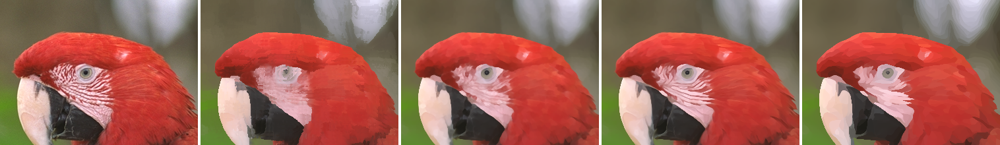

# kuwahara

Kuwahara filters in Rust: edge-preserving smoothing that turns photographs into flat, painterly
patches of colour.



*Left to right: original, classic, generalized, anisotropic, anisotropic three times.*

- **Classic**: Kuwahara, Hachimura, Eiho and Kinoshita, *Processing of RI-angiocardiographic
  images* (1976). Four square regions around each pixel; the one with the least variance gives
  the output. Blocky.
- **Anisotropic**: Jan Eric Kyprianidis, Henry Kang and Jürgen Döllner,
  [*Image and Video Abstraction by Anisotropic Kuwahara Filtering*](https://www.kyprianidis.com/p/pg2009/)
  (Pacific Graphics 2009). An ellipse that follows the local orientation of the image, taken from
  the smoothed structure tensor, divided into eight smoothly weighted, overlapping sectors. Each
  sector's mean counts in proportion to how uniform it is, so edges stay sharp and strokes follow
  the shapes of the picture.
- **Generalized**: the anisotropic filter with the ellipse held circular (`alpha = ∞`):
  Papari, Petkov and Campisi, *Artistic Edge and Corner Enhancing Smoothing* (IEEE TIP 2007).
- Two sector weightings: the 2009 paper's, a sector convolved with a Gaussian and sampled into a
  table, and the polynomial weights of Kyprianidis, Semmo, Kang and Döllner,
  [*Anisotropic Kuwahara Filtering with Polynomial Weighting Functions*](https://doi.org/10.2312/LocalChapterEvents/TPCG/TPCG10/025-030)
  (EG UK TPCG 2010), which look the same and are faster (the default).

No dependencies. The filters read and write an `Image` of `f32` RGB; rows are filtered in
parallel with `std::thread`.

## Example

```rust
use kuwahara::{Image, Params, anisotropic};

let image = Image::filled(32, 32, [0.2, 0.4, 0.6]);
let painted = anisotropic(&image, &Params::default());
assert_eq!(painted.pixels.len(), 32 * 32);
```

To filter an image file:

```sh
cargo run --release --example filter -- input.png output.png
cargo run --release --example filter -- input.png output.png --passes 3 --radius 8
cargo run --release --example filter -- input.png output.png --classic
cargo run --release --example filter -- input.png output.png --isotropic
cargo run --release --example filter -- input.png field.png --orientation
```

The test photographs in `images/input/` are from the
[Kodak Lossless True Color Image Suite](https://r0k.us/graphics/kodak/), released by Eastman Kodak
for unrestricted use.

## Parameters

| Field | Default | Meaning |
|---|---|---|
| `radius` | 6 | Filter radius `r` in isotropic areas; the ellipse ranges from `r/2` to `2r`. |
| `q` | 8 | Sharpness: how strongly the most uniform sectors win. |
| `alpha` | 1 | Eccentricity control; `f32::INFINITY` gives the generalized (circular) filter. |
| `sigma` | 2 | Smoothing of the structure tensor. |
| `sectors` | 8 | Number of sectors `N`. |
| `scale` | 255 | The papers' weights assume channels in `0..=255`; deviations are scaled by this. |
| `weighting` | `Polynomial` | `Convolved` (2009) or `Polynomial` (2010, with optional `zeta`, `eta`). |

## Papers

The papers are listed in [`docs/`](docs/README.md); Kyprianidis's dissertation, which covers the
filter in full, is included there under its own Creative Commons licence.

## Licence

MIT or Apache-2.0, at your option.
